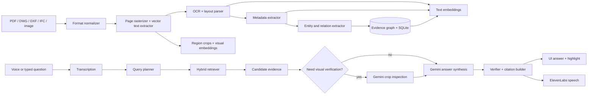
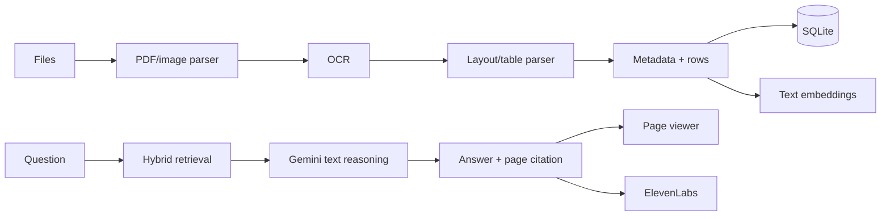
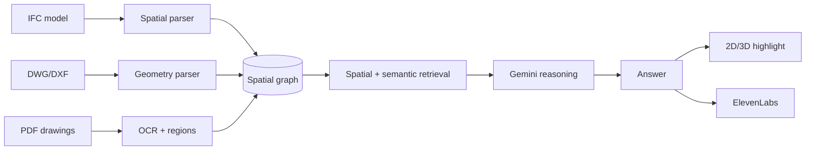

M# Make Blueprints Talk — BlueprintTrace Plan Document

**Track:** Make Blueprints Talk, by Stoa  
**Product:** BlueprintTrace — *Ask the building. See the proof.*  
**Team:** Two software-engineering students  
**Primary architecture:** Drawing Evidence Graph + Region-Grounded RAG  
**Fallback architecture:** OCR/Table-First Verifiable Q&A  

## Executive summary

BlueprintTrace is a voice-first, retrieval-first assistant for construction drawings. A site engineer asks a natural-language question by voice or text and receives a concise answer, an explicit source citation, and a highlighted region on the relevant drawing.

The system does not send an entire drawing corpus to a large multimodal model. Instead, it preprocesses drawings into searchable, spatially addressable evidence: sheets, OCR text, title-block metadata, schedules, regions, cross-references, revisions, and optional IFC/DWG entities. At question time, it retrieves a small set of candidates, optionally asks Gemini to inspect one or more small crops, and generates an evidence-constrained answer.

The core product promise is verifiability: every material answer links to a sheet, page, extracted quote, and visual highlight that a human can inspect in seconds.

## Problem and user insight

Construction engineers spend substantial time locating information across large drawing sets. They need operational answers, not generic document chat.

Example questions:

- “What is the fire rating of the wall between room 214 and the corridor?”
- “Which drawing shows the reinforcement detail for slab S3?”
- “What pipe diameter serves the kitchen?”
- “What changed between revision C and D on sheet A-201?”
- “Which contractor is responsible for the waterproofing detail?”
- “Where is door D-12 scheduled, and what is its width?”
- “What does symbol K-4 mean on this sheet?”

A useful answer must be grounded in the supplied drawings or models and immediately verifiable through a sheet reference, extracted text, and highlighted region.

## Domain research findings

### Construction drawing structure

A drawing set is a linked system rather than a collection of independent pages.

| Artifact | Contains | Retrieval requirement |
|---|---|---|
| Architectural plans | Rooms, walls, doors, windows, finishes, dimensions, grids | Room, wall, door, and finish queries |
| Elevations and sections | Vertical relationships, façades, levels, buildups | Height, layer, and construction questions |
| Structural plans | Beams, columns, slabs, reinforcement, loads, notes | Member and reinforcement questions |
| MEP plans | Ducts, pipes, cables, fixtures, valves, equipment | Service, route, and size questions |
| Details | Enlarged assemblies | Material, buildup, and fire-rating questions |
| Schedules | Doors, windows, finishes, equipment, room data | Exact tabular attributes |
| Legends and symbols | Meaning of graphical marks | Symbol interpretation |
| Title blocks | Project, sheet number, revision, scale, date, discipline | Citation and filtering |
| Revision clouds/tables | Changes and dates | Change and revision questions |

### Drawing-native evidence

The ingestion layer preserves:

- Sheet identity: project, building, discipline, sheet number, revision, title, scale, date, language.
- Page geometry: dimensions, rotation, vector text, raster areas, viewports, crops.
- OCR spans: text, confidence, language, normalized bounding boxes.
- Visual regions: title block, legend, plan viewport, detail, section, schedule table, revision area.
- Cross-references: “SEE DETAIL 5/A-501,” room tags, door tags, pipe tags.
- Entities: rooms, doors, walls, pipes, ducts, beams, columns, equipment, details, schedules.
- Relations: room-to-wall, wall-to-wall-type, door-tag-to-schedule-row, detail-reference-to-detail-sheet, revision-to-affected-sheet.

This structure enables precise retrieval and visual localization instead of returning an entire page as evidence.

### Why naive VLM pipelines fail

General-purpose vision-language models often struggle with dense technical drawings because:

- Small annotations and dimensions become illegible when full pages are compressed.
- Similar labels can be confused across rooms, pipes, doors, and revisions.
- Legends and symbols require project-specific interpretation.
- Multi-page references require following links rather than answering from one page.
- Models can hallucinate plausible values unless constrained to quote and localize evidence.
- Visual retrieval alone may locate a page but not establish the exact attribute.

The strongest approach combines OCR/parsing, hybrid retrieval, selective visual inspection, structured evidence extraction, and verification.

## Product vision and demo narrative

A judge speaks or types:

> “What is the fire rating of the wall between room 214 and the corridor?”

BlueprintTrace responds with:

1. A concise answer: “The wall between room 214 and the corridor is EI 60, according to wall type W-12.”
2. A drawing viewer with a red highlight around the wall type callout or schedule row.
3. Citation chips: `A-201 rev D, page 3, region 4`; `Fire-rating schedule, row W-12`; `Specification 07 21 00, section 2.3`.
4. Extracted evidence: “W-12 — EI 60 — gypsum shaft wall.”
5. A confidence state: `Verified`, `Partial evidence`, or `Cannot verify`.
6. ElevenLabs speech: “The wall between room 214 and the corridor is EI 60. I’ve highlighted the wall type callout on sheet A-201 and the fire-rating schedule row.”

The user can follow up: “Show me the detail referenced by that wall type.” The system opens the linked detail and highlights the relevant region.

## Final build decisions

| Decision | Choice |
|---|---|
| Team | Two software-engineering students |
| Primary plan | Drawing Evidence Graph + Region-Grounded RAG |
| Guaranteed fallback | OCR/Table-First Verifiable Q&A |
| Frontend | React + Vite + TypeScript |
| Backend | Python FastAPI |
| Database | SQLite; PostgreSQL/pgvector only if time permits |
| Search | SQLite FTS5 plus lightweight vector search |
| AI | Gemini API for planning, synthesis, and selective visual verification |
| Voice | Browser audio capture, transcription, ElevenLabs speech |
| Language | English-first; Finnish normalization only as a final stretch |
| Company documents | Optional late add-on; not assumed |
| Demo mode | Typed and live voice, with cached offline fallback |
| Hardware | No GPU assumptions; CPU-friendly preprocessing and cloud inference |

## Three plans of attack

### Plan A — Drawing Evidence Graph + Region-Grounded RAG

**Thesis:** Build a spatially addressable evidence graph during ingestion, then use cheap retrieval to select a tiny visual crop for Gemini to verify and explain.

#### User experience

1. User selects a project or uploads a drawing set.
2. The system ingests files and displays processing progress: sheets, extracted text, schedules, revisions, and indexed regions.
3. User speaks or types a question.
4. UI shows status: “Interpreting question → searching sheets → inspecting evidence → composing answer.”
5. Answer appears with citations, confidence, and a highlighted region.
6. User clicks a citation to open the source sheet and crop.
7. User asks a voice follow-up; prior context and evidence remain available.

#### Architecture



#### Data pipeline

| Input | Extraction | Stored |
|---|---|---|
| PDF | Page images, embedded text, vector geometry where accessible, page rotation, title block | `documents`, `pages`, `text_spans`, `regions`, `sheets` |
| DWG/DXF | Layer names, entity types, text entities, coordinates, blocks, layouts | `entities`, `layers`, `text_spans`, `regions` |
| IFC | IfcSpace, IfcWall, IfcDoor, IfcPipe, properties, relationships, GUIDs | `objects`, `properties`, `relations` |
| Image/scanned sheet | OCR, layout zones, visual embeddings, detected tables | `pages`, `text_spans`, `regions`, `visual_chunks` |
| Specification/notes | Chunked text, headings, clause IDs, revision/date | `knowledge_chunks` |

Each sheet receives:

- `sheet_id`, `file_id`, `page_number`, `discipline`, `sheet_number`, `title`, `revision`, `revision_date`, `scale`, `language`, `project_id`, `building_id`, `floor_id`.
- OCR spans with normalized bounding boxes.
- Region crops for title block, legend, schedule tables, plan viewport, details, sections, and revision areas.
- Embeddings for text chunks, table rows, entity summaries, and visual crops.
- Graph edges such as `REFERENCES`, `BELONGS_TO`, `HAS_PROPERTY`, `LOCATED_IN`, `REVISED_FROM`, `SCHEDULED_AS`.

#### Gemini integration

Gemini is used at four controlled points:

1. Query planning: classify intent, extract entities, generate retrieval filters.
2. Metadata/table reasoning: resolve ambiguous references from retrieved text and table rows.
3. Visual verification: inspect one to three small crops when text evidence is insufficient or conflicting.
4. Answer synthesis: produce a concise answer with mandatory citations.

Query planner output:

```json
{
  "intent": "attribute_lookup",
  "entity": "W-12",
  "attributes": ["fire_rating"],
  "disciplines": ["architectural", "fire_safety"],
  "sheet_types": ["plan", "schedule", "detail"],
  "language": "en",
  "needs_visual_verification": true
}
```

Answer synthesis output:

```json
{
  "answer": "The wall between room 214 and the corridor is EI 60.",
  "answer_type": "attribute_lookup",
  "confidence": "high",
  "evidence": [
    {
      "sheet_id": "A-201",
      "page": 3,
      "region_id": "reg_842",
      "bbox": [0.31, 0.42, 0.48, 0.51],
      "quote": "W-12 EI 60",
      "source_type": "drawing_text"
    }
  ],
  "missing_information": [],
  "follow_up_suggestion": "Show the wall type W-12 detail."
}
```

Validation rules:

- Reject answers with zero evidence.
- Require bbox coordinates within `[0,1]` and an existing `region_id` or `text_span_id`.
- Require a quoted span for text-based claims.
- If Gemini claims a value not present in retrieved evidence, downgrade to `cannot_verify`.
- Cache query plans and final answers by normalized question plus project/version.

#### ElevenLabs integration

- Browser captures audio with `MediaRecorder`.
- Backend transcribes audio; Gemini receives the transcript, not raw audio.
- UI displays the transcript immediately and allows correction.
- Gemini returns a spoken-answer field of no more than 45 words.
- ElevenLabs converts only that concise field to speech.
- Render the answer and citations before speech playback completes.
- Provide mute, replay, transcript editing, and typed input.

#### RAG / project knowledge base

Create a project-scoped knowledge base containing:

- Drawing sheets, OCR, regions, schedules, revisions.
- Optional specifications, standards, meeting notes, contracts, RFIs, and company FAQs.
- Optional user-uploaded PDF, DOCX, Markdown, CSV, or text documents.

Retrieval score:

```text
score =
  0.45 * semantic_similarity
+ 0.30 * keyword_match
+ 0.15 * metadata_match
+ 0.10 * graph_proximity
```

Metadata filters include discipline, revision, floor, sheet type, language, entity type, and date.

#### Verification and explainability

The evidence panel always shows:

- Sheet thumbnail and page number.
- Red bounding box over the supporting region.
- Extracted quote or table row.
- Source type: drawing text, schedule, specification, IFC property, or revision note.
- Confidence and missing-evidence explanation.
- “Open in drawing” action that centers and zooms the viewer on the region.

If evidence conflicts, show both sources and state the conflict rather than silently choosing one.

#### Accuracy strategy

- Preserve embedded PDF text before OCR.
- Use OCR at high resolution for title blocks, tables, legends, and annotation-dense zones.
- Normalize English construction terms, units, and abbreviations.
- Use retrieval filters before visual inference.
- Ask Gemini to verify only selected crops.
- Maintain a `cannot_verify` path.
- Build a small evaluation set from the preview dataset before finalizing prompts.

#### Cost strategy

| Operation | Cost profile | Control |
|---|---|---|
| Full-corpus VLM analysis | Very high | Never do during Q&A |
| Full-page VLM analysis | High | Use only for ambiguous cases |
| Crop VLM verification | Medium | Limit to top 1–3 crops |
| Embedding generation | Low/medium | Once at ingestion; cache |
| OCR | Medium CPU | Run selectively and cache |
| Text-only Gemini reasoning | Low | Default path |
| Repeated identical questions | Zero marginal model cost | Answer cache |

#### Build plan

**Minimum viable demo**

- PDF/image ingestion.
- Page OCR and title-block parsing.
- Text, table-row, and region indexing.
- Typed question answering.
- Gemini answer synthesis with citations.
- Bounding-box highlight in a simple viewer.
- ElevenLabs speech.
- At least 10 curated demo questions.

**Stretch goals**

- DWG/DXF entity extraction.
- IFC property queries.
- Revision comparison.
- Cross-reference following.
- Voice follow-up context.
- Visual crop verification.
- Company knowledge-base upload.

**Team split**

| Owner | Responsibility |
|---|---|
| Person 1 — Ingestion and retrieval | Dataset inspection, PDF/image parsing, OCR, metadata extraction, SQLite schema, embeddings, hybrid retrieval, Gemini query planner, caching |
| Person 2 — Product and reasoning | React UI, sheet viewer, evidence panel, bounding-box highlighting, Gemini answer/verification integration, ElevenLabs voice, demo script, evaluation |

**Critical path**

1. Load and inspect the preview dataset.
2. Build PDF/image ingestion and OCR.
3. Build sheet metadata extraction.
4. Build retrieval and answer API.
5. Build evidence viewer and highlight.
6. Add voice.
7. Add visual verification and cross-references.

**Cut order if behind**

1. DWG/DXF parsing.
2. IFC integration.
3. Visual embeddings.
4. Revision diffing.
5. Advanced graph traversal.
6. Multilingual OCR optimization.

#### Evaluation

Use 15–25 questions across:

- Attribute lookup.
- Schedule lookup.
- Spatial/room lookup.
- Cross-reference lookup.
- Revision question.
- Specification question.
- Unanswerable question.

| Metric | Target |
|---|---|
| Answer correctness | 80%+ on curated set |
| Citation precision | 85%+ |
| Evidence localization | Correct sheet and plausible region in 80%+ |
| Median typed-query latency | Under 8 seconds |
| Voice-query latency | Under 15 seconds |
| Cost per query | Retrieval plus at most one crop call |
| Unanswerable handling | Correct refusal in at least 80% of cases |

#### Risks and mitigations

| Risk | Mitigation |
|---|---|
| OCR fails on scanned drawings | Use embedded text first; crop-and-zoom OCR; retain image fallback |
| Wrong sheet selected | Hybrid retrieval with metadata filters |
| Wrong region highlighted | Require text-span evidence where possible; show multiple candidates |
| Gemini hallucination | Evidence-constrained prompt and validator |
| Dataset format surprises | Inspect preview before committing to parsers |
| Voice latency | Parallelize transcription, retrieval, and UI rendering |
| Demo failure | Local cached demo project and typed fallback |

#### Why it wins

- **Accuracy:** retrieval filters plus crop verification reduce irrelevant context.
- **Verification:** every answer has a sheet, quote, and highlighted region.
- **Creativity:** the evidence graph links text, geometry, schedules, revisions, and visual regions.
- **Low inference cost:** expensive vision is selective and cached; most queries are retrieval-first.

### Plan B — OCR/Table-First Verifiable Q&A

**Thesis:** Treat construction drawings primarily as structured text, tables, tags, and metadata; use vision only as a targeted fallback.

#### User experience

The user asks a question and receives an answer with a table-row citation, extracted text, and page-level highlight. This is less visually dramatic than Plan A but highly reliable for schedules, specifications, title blocks, and revision notes.

#### Architecture



#### Data pipeline

- Extract embedded PDF text first.
- OCR raster pages with orientation detection.
- Detect tables using layout heuristics or a table parser.
- Parse title blocks with regex/templates.
- Store every OCR span with coordinates.
- Create embeddings over OCR chunks, table rows, and metadata summaries.
- Keep page images for highlighting, but do not create visual embeddings initially.

#### Gemini integration

Gemini receives:

- Normalized question.
- Top 10–20 text/table candidates.
- Sheet metadata.
- Optional page thumbnail only when needed.

It must return:

```json
{
  "answer": "Door D-12 is 900 mm wide.",
  "citations": [
    {
      "page": 7,
      "quote": "D-12 900x2100",
      "bbox": [0.2, 0.4, 0.5, 0.45]
    }
  ],
  "confidence": "high",
  "cannot_verify": false
}
```

#### Verification and explainability

The UI shows the page, OCR quote, table row, and page-level rectangle. This is easy to build and difficult to break.

#### Accuracy strategy

- Focus on questions answerable from explicit text.
- Use exact-match validation for dimensions, codes, and tags.
- Do not answer geometric questions without a visual verification path.

#### Cost strategy

This is the cheapest architecture: no visual embeddings, no crop calls by default, and text-only Gemini calls.

#### Build plan

Can be built in 12–18 hours by a two-person team. It is the best fallback if dataset formats or vision components prove difficult.

#### Why it wins

It maximizes reliability and cost efficiency, but is less creative and weaker on spatial questions.

### Plan C — Spatial Twin + BIM-Linked Reasoning

**Thesis:** Build a lightweight spatial model that links drawings, IFC objects, rooms, and disciplines, enabling spatial questions and cross-document traversal.

#### User experience

The user asks, “Which rooms are served by pipe P-12?” or “Show all fire-rated walls on level 2.” The UI displays a floor plan or 3D/BIM view with highlighted objects, plus drawing evidence.

#### Architecture



#### Data pipeline

- Parse IFC spatial hierarchy: site, building, storey, space, element.
- Extract object GUIDs, types, properties, and relationships.
- Parse DWG/DXF layers and entities where feasible.
- Match drawing tags to IFC objects using names, coordinates, and heuristics.
- Build spatial indexes for rooms, walls, pipes, and equipment.
- Support queries such as adjacency, containment, level, and route.

#### Gemini integration

Gemini interprets natural-language spatial intent and synthesizes answers from structured graph results. It should not perform raw geometry reasoning over full drawings.

```json
{
  "answer": "Pipe P-12 serves rooms 214, 215, and 216.",
  "spatial_evidence": [
    {"object_guid": "...", "type": "IfcPipe", "level": "2"}
  ],
  "drawing_evidence": [
    {"sheet": "M-201", "bbox": [0.4, 0.3, 0.6, 0.4]}
  ]
}
```

#### Verification and explainability

Users can inspect both the spatial object and the source drawing region. This is powerful but requires more integration work.

#### Accuracy strategy

Use IFC properties as authoritative when present; use drawings for visual confirmation and references. Do not infer geometry from OCR alone.

#### Cost strategy

Most queries are graph/database queries. Gemini is used for intent parsing and final synthesis.

#### Build plan

This is high risk in 24–48 hours unless the dataset contains clean IFC models and predictable DWG files. Build it only after Plan A’s core is stable.

#### Why it wins

It is the most differentiated and closest to production construction AI, but has the highest integration risk.

## Plan comparison and recommendation

| Plan | Core approach | Accuracy potential | Verification strength | Creativity | Inference cost | Build risk | Best fit |
|---|---|---:|---:|---:|---:|---:|---|
| A: Evidence Graph + Region RAG | Structured drawing evidence, hybrid retrieval, selective crop verification | High | Very high | High | Medium-low | Medium | **Recommended hackathon plan** |
| B: OCR/Table-First | Text, tables, metadata, page-level citations | Medium-high | High | Medium | Very low | Low | Reliable fallback |
| C: Spatial Twin + BIM | IFC/DWG geometry and spatial graph | High if data is clean | Very high | Very high | Low after ingestion | High | Stretch/production direction |

**Recommendation:** Build Plan A, with Plan B as its guaranteed fallback. Implement ingestion and retrieval first; add visual verification only after the text/table path works. If IFC/DWG parsing becomes unstable, retain the evidence graph but restrict it to PDF/image sheets, OCR, schedules, and metadata.

## Detailed implementation plan

### System architecture

- **Frontend:** React + Vite + TypeScript; PDF.js or image-based sheet viewer; Web Audio API for recording.
- **Backend:** Python FastAPI.
- **Database:** SQLite for hackathon; PostgreSQL + pgvector for production.
- **Search:** SQLite FTS5 plus vector search; production can use Qdrant or pgvector.
- **Storage:** Local filesystem or object storage; retain original files, page images, crops, and JSON extraction artifacts.
- **AI:** Gemini for query planning, synthesis, and selective visual verification; ElevenLabs for speech.
- **Deployment:** Docker Compose locally; frontend and API can run on one machine for the live demo.

### Repository structure

```text
blueprint-trace/
├── backend/
│   ├── app/
│   │   ├── main.py
│   │   ├── api/
│   │   │   ├── projects.py
│   │   │   ├── ingest.py
│   │   │   ├── query.py
│   │   │   └── voice.py
│   │   ├── ingestion/
│   │   │   ├── pdf_ingest.py
│   │   │   ├── dwg_ingest.py
│   │   │   ├── ifc_ingest.py
│   │   │   ├── ocr.py
│   │   │   ├── layout.py
│   │   │   ├── tables.py
│   │   │   ├── metadata.py
│   │   │   └── embeddings.py
│   │   ├── retrieval/
│   │   │   ├── hybrid_search.py
│   │   │   ├── filters.py
│   │   │   └── graph.py
│   │   ├── reasoning/
│   │   │   ├── gemini_client.py
│   │   │   ├── prompts.py
│   │   │   ├── schemas.py
│   │   │   └── verifier.py
│   │   ├── voice/
│   │   │   ├── transcription.py
│   │   │   └── elevenlabs.py
│   │   └── db/
│   │       ├── models.py
│   │       └── migrations.sql
│   ├── tests/
│   └── pyproject.toml
├── frontend/
│   ├── src/
│   │   ├── App.tsx
│   │   ├── api.ts
│   │   ├── components/
│   │   │   ├── SheetViewer.tsx
│   │   │   ├── EvidencePanel.tsx
│   │   │   ├── VoiceRecorder.tsx
│   │   │   └── AnswerCard.tsx
│   └── package.json
├── data/
│   ├── raw/
│   ├── processed/
│   └── eval/
├── docker-compose.yml
├── .env.example
└── README.md
```

### Data model and schemas

```sql
CREATE TABLE projects (
  id TEXT PRIMARY KEY,
  name TEXT NOT NULL,
  language TEXT DEFAULT 'en',
  created_at TEXT NOT NULL
);

CREATE TABLE documents (
  id TEXT PRIMARY KEY,
  project_id TEXT REFERENCES projects(id),
  filename TEXT NOT NULL,
  file_type TEXT NOT NULL,
  sha256 TEXT NOT NULL,
  status TEXT NOT NULL,
  created_at TEXT NOT NULL
);

CREATE TABLE sheets (
  id TEXT PRIMARY KEY,
  document_id TEXT REFERENCES documents(id),
  page_number INTEGER NOT NULL,
  sheet_number TEXT,
  title TEXT,
  discipline TEXT,
  revision TEXT,
  revision_date TEXT,
  scale TEXT,
  language TEXT,
  width REAL,
  height REAL,
  rotation REAL
);

CREATE TABLE text_spans (
  id TEXT PRIMARY KEY,
  sheet_id TEXT REFERENCES sheets(id),
  text TEXT NOT NULL,
  normalized_text TEXT,
  bbox_x0 REAL,
  bbox_y0 REAL,
  bbox_x1 REAL,
  bbox_y1 REAL,
  confidence REAL,
  source TEXT
);

CREATE TABLE regions (
  id TEXT PRIMARY KEY,
  sheet_id TEXT REFERENCES sheets(id),
  region_type TEXT,
  bbox_x0 REAL,
  bbox_y0 REAL,
  bbox_x1 REAL,
  bbox_y1 REAL,
  crop_path TEXT,
  summary TEXT
);

CREATE TABLE entities (
  id TEXT PRIMARY KEY,
  project_id TEXT,
  sheet_id TEXT,
  external_id TEXT,
  entity_type TEXT,
  name TEXT,
  properties_json TEXT
);

CREATE TABLE relations (
  id TEXT PRIMARY KEY,
  source_id TEXT,
  target_id TEXT,
  relation_type TEXT,
  evidence_region_id TEXT
);

CREATE TABLE knowledge_chunks (
  id TEXT PRIMARY KEY,
  project_id TEXT,
  document_id TEXT,
  chunk_text TEXT,
  section TEXT,
  page INTEGER,
  language TEXT,
  embedding BLOB
);

CREATE TABLE query_cache (
  id TEXT PRIMARY KEY,
  project_id TEXT,
  normalized_question TEXT,
  response_json TEXT,
  created_at TEXT
);
```

### API and integration design

| Method | Endpoint | Purpose |
|---|---|---|
| `POST` | `/api/projects` | Create project |
| `POST` | `/api/projects/{id}/ingest` | Upload files |
| `GET` | `/api/projects/{id}/sheets` | List processed sheets |
| `POST` | `/api/projects/{id}/ask` | Typed question |
| `POST` | `/api/projects/{id}/voice` | Upload audio; returns transcript, answer, evidence, speech |
| `GET` | `/api/evidence/{region_id}/crop` | Return cropped image |
| `GET` | `/api/sheets/{sheet_id}/render` | Return rendered page |
| `POST` | `/api/projects/{id}/knowledge` | Add specifications/notes/FAQs |

Example typed request:

```json
{
  "question": "What is the fire rating of wall W-12?",
  "filters": {"discipline": "architectural"},
  "voice": false
}
```

Example response:

```json
{
  "answer": "Wall type W-12 has a fire rating of EI 60.",
  "confidence": "high",
  "citations": [
    {
      "sheet_number": "A-201",
      "page": 3,
      "region_id": "reg_842",
      "quote": "W-12 EI 60",
      "bbox": [0.31, 0.42, 0.48, 0.51]
    }
  ],
  "speech": "Wall type W-12 has a fire rating of EI 60. The evidence is highlighted on sheet A-201.",
  "retrieval_trace": {
    "filters": {"discipline": "architectural"},
    "candidates": 18,
    "visual_verification": true
  }
}
```

### Gemini prompts and structured output

#### Query planner prompt

```text
You are a construction-document query planner.

Given a user question and project metadata, return JSON only.

Identify:
- intent
- target entity or tag
- required attributes
- likely disciplines
- likely sheet types
- language
- whether visual inspection is likely needed

Do not answer the question.

User question: {question}
Project context: {project_context}
```

#### Answer synthesis prompt

```text
You are a construction drawing assistant.

Use only the supplied evidence. Do not use outside knowledge.

Rules:
1. Answer concisely for a construction engineer.
2. Cite every factual claim.
3. Use only evidence IDs provided.
4. If evidence is insufficient or conflicting, set cannot_verify=true.
5. Return a spoken answer of no more than 45 words.
6. Do not invent dimensions, ratings, materials, or responsibilities.

Question: {question}
Evidence: {evidence_json}
Conversation context: {context}
```

#### Visual verification prompt

```text
Inspect this cropped construction-drawing region.

Question: {question}
Candidate answer: {candidate_answer}
OCR text nearby: {ocr_text}

Return JSON:
- whether the crop supports the answer
- exact quoted text
- bounding box for the supporting element
- confidence
- reason if unsupported

Do not infer values absent from the crop.
```

### ElevenLabs voice UX

- Record in 16 kHz mono WebM/Opus or WAV.
- Show a waveform and live “Listening…” state.
- Display transcript before submission; allow one-tap correction.
- Run transcription and retrieval in parallel where possible.
- Speak only the `speech` field, not the full technical explanation.
- Provide replay, mute, and text fallback.
- Keep follow-up context: prior sheet, entity, and evidence IDs.

### RAG / knowledge-base design

Support three scopes:

1. **Project:** drawings, revisions, specifications, meeting notes.
2. **Company:** standards, templates, typical details, FAQs.
3. **Global:** general construction terminology and unit normalization.

For the hackathon, implement project scope first. A company can upload PDFs, DOCX, Markdown, spreadsheets, or text. The ingestion service chunks documents by headings and clauses, retains section IDs and page numbers, creates embeddings, and links chunks to projects or company scope.

### Verification and evidence UI

The answer card contains:

- Answer.
- Confidence badge.
- Citation chips.
- Evidence quotes.
- Sheet viewer with highlighted bbox.
- Retrieval trace: filters used, candidates considered, whether visual verification occurred.
- “Why can’t you verify this?” explanation for insufficient evidence.

Bounding boxes use normalized coordinates:

```text
x_norm = x_pixels / page_width
y_norm = y_pixels / page_height
```

This allows the same coordinates to work across rendered resolutions.

### Evaluation plan

Create `data/eval/questions.jsonl`:

```json
{
  "id": "q001",
  "question": "What is the fire rating of wall W-12?",
  "expected_answer": "EI 60",
  "expected_sheet": "A-201",
  "evidence_type": "text_or_schedule",
  "category": "attribute_lookup"
}
```

Evaluate after each major change. Track correctness, citation precision, localization, latency, cost, and refusal quality.

## Hackathon build schedule

### First 90 minutes

1. Download and unzip the preview dataset.
2. Inventory extensions, page counts, languages, and sample questions.
3. Create repository, environment variables, and database schema.
4. Implement PDF/image upload and page rendering.
5. Extract embedded PDF text; run OCR only where needed.
6. Parse title blocks with regex/templates.
7. Store sheets, text spans, and page images.
8. Implement basic keyword plus vector retrieval.
9. Create one Gemini answer endpoint with citations.
10. Render a page with a hardcoded or OCR-derived highlight.
11. Test five questions.

### Hours 2–12

- Build schedule/table extraction.
- Add metadata filters.
- Add evidence panel and citation chips.
- Add Gemini query planner.
- Add answer cache.
- Build typed demo flow.
- Create 15–20 question evaluation set.

### Hours 12–24

- Add voice recording, transcription, and ElevenLabs.
- Add crop generation and Gemini visual verification.
- Add cross-reference following.
- Add revision metadata.
- Polish UI and demo project.

### Hours 24–48

- Add DWG/DXF or IFC support only if the dataset justifies it.
- Add spatial graph queries.
- Add revision comparison.
- Add multilingual query normalization.
- Rehearse demo and prepare offline fallback.

## Demo script

1. Open BlueprintTrace with the prepared project already ingested.
2. Type: “What is the fire rating of wall W-12?”
3. Show the spoken answer and highlighted wall callout.
4. Click the citation to open sheet A-201.
5. Ask by voice: “Show me the detail referenced by that wall type.”
6. Show the linked detail and highlighted region.
7. Ask: “What changed in the latest revision of this sheet?”
8. Show revision note and changed region.
9. Ask an intentionally ambiguous question.
10. Show the system refusing to fabricate and explaining what evidence is missing.

## Risks, fallbacks, and cut list

| Risk | Mitigation |
|---|---|
| Dataset contains mostly scans | Prioritize OCR, layout parsing, and image-region retrieval |
| Gemini crop coordinates inaccurate | Use OCR-derived boxes as primary; use model boxes only as secondary |
| Voice adds latency | Start speech after answer; offer typed mode |
| IFC/DWG parsing fails | Cut to PDF/image pipeline |
| Multilingual questions fail | Normalize common Finnish/English construction terms |
| Live internet/API failure | Cache answers and pre-render evidence crops |

**Cut first:** IFC, DWG, visual embeddings, revision diffing, multilingual optimization, advanced graph traversal.

**Never cut:** citations, bounding-box highlight, `cannot_verify` behavior, cached demo project, typed fallback.

## Final two hours before judging

- [ ] Re-ingest the demo project from scratch.
- [ ] Run all 15–20 evaluation questions.
- [ ] Fix any answer with a missing or incorrect citation.
- [ ] Verify every bbox renders inside the sheet viewer.
- [ ] Test voice on the actual demo laptop and microphone.
- [ ] Test typed fallback.
- [ ] Pre-cache answers for the five core demo questions.
- [ ] Prepare offline screenshots or a recorded screen capture.
- [ ] Prepare a 90-second pitch: problem, approach, live demo, evidence, cost story.
- [ ] Remove debug panels, console errors, and unfinished features.
- [ ] Confirm API keys, rate limits, and internet connectivity.
- [ ] Rehearse the full demo twice.

## Questions resolved

- Team size: two software-engineering students.
- Hardware: no local GPU assumed.
- Stack: React + Vite + TypeScript frontend; Python FastAPI backend.
- Dataset: preview dataset will be downloaded and inspected before final implementation choices.
- Gemini: API key available with high limit.
- ElevenLabs: Creator plan available.
- Language: English first; Finnish last.
- Input: optimize for both typed and live voice.
- Scope: Stoa track only; no separate Entire-track integration.
- Company documents: not available; optional late add-on.
- Example questions: not provided in advance.
- Product constraints: none specified beyond the Stoa brief.
